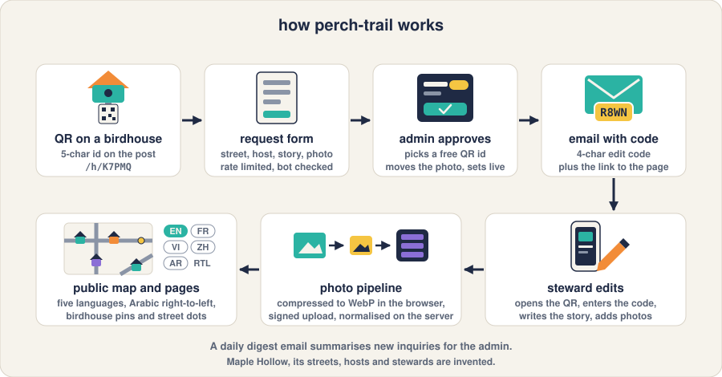
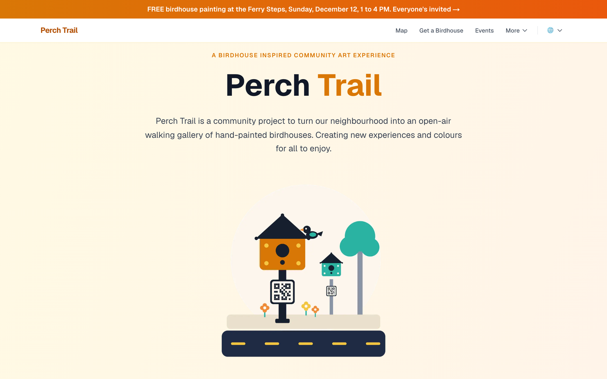
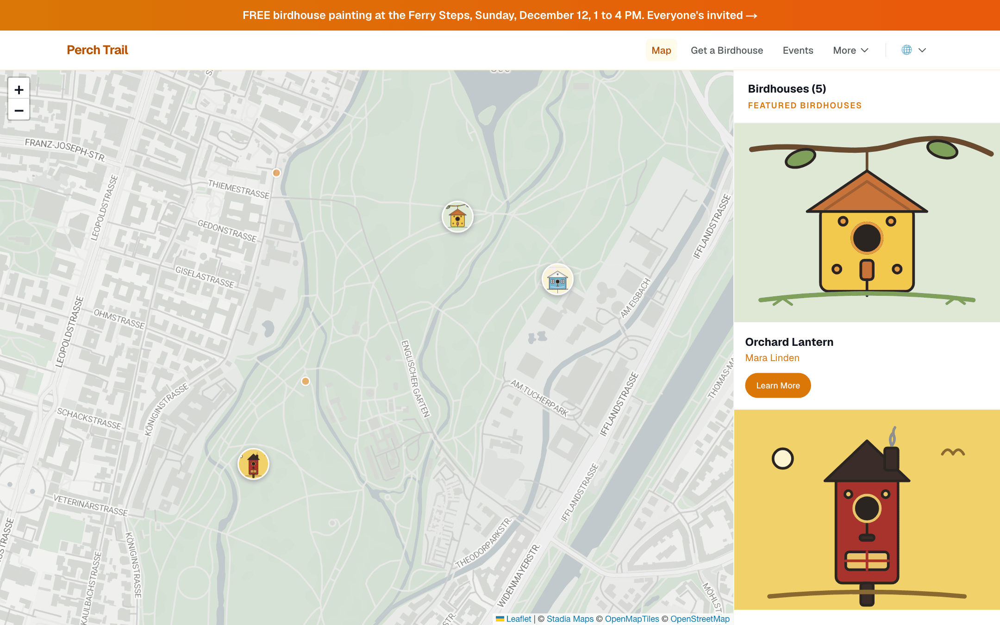
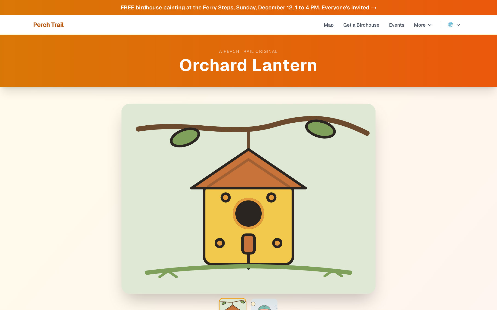
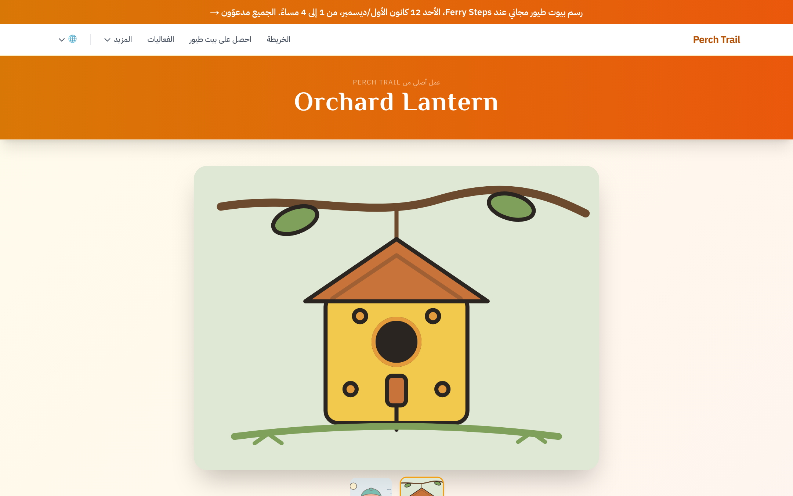
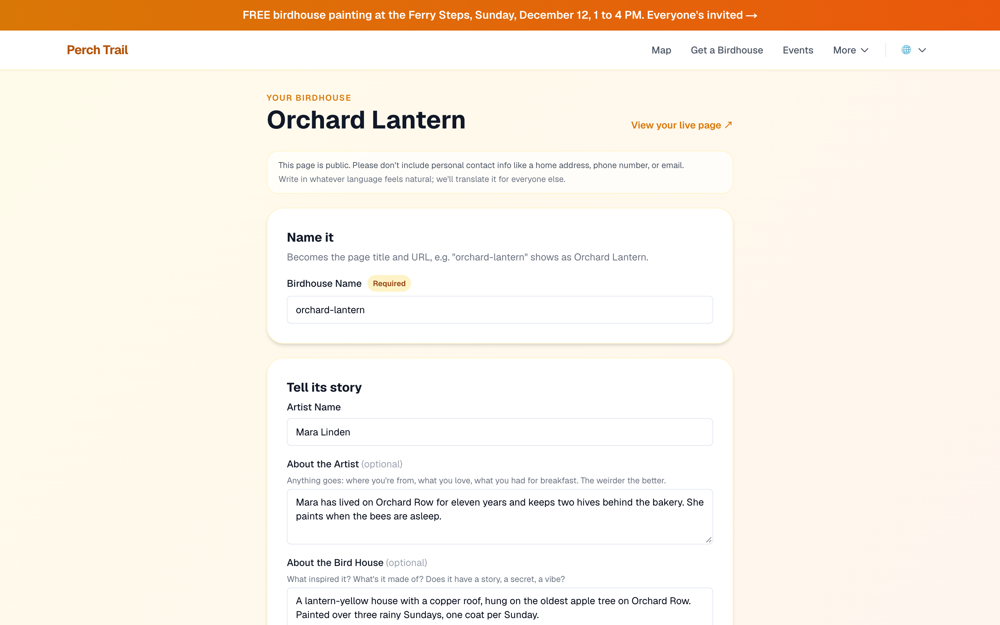
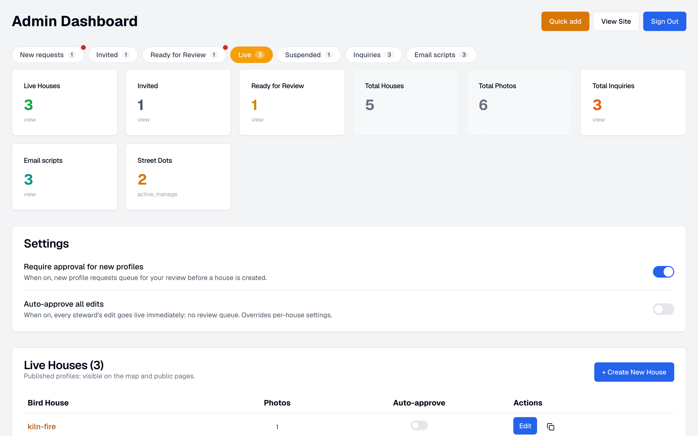

# perch-trail

A neighbourhood trail of hand-painted birdhouses, each with a QR code that opens its own story page.

The animation shows a phone scanning a birdhouse's QR code, the steward opening
the page with a four-character edit code and writing the story, the map filling
with birdhouses, one page in five languages including right-to-left Arabic, and
an admin approving a request, which emails the new steward their code. A still
version is at [docs/explainer.png](docs/explainer.png).

People paint birdhouses and hang them on their street. Each one carries a QR
code. Scanning it opens a page with the house's photos, its story and the artist
behind it, and a map of every other house on the trail. The person who looks
after a house (the steward) edits that page with a short code from their welcome
email, no account needed. One admin approves new requests, reviews edits, answers
inquiries and manages the trail from a dashboard.

This is the code behind [Painted Perches](https://paintedperches.ca), released
with every real place, person and photo replaced by an invented neighbourhood.

## What is in the box

- **Public site** in five languages (English, French, Vietnamese, Simplified
  Chinese, Arabic with right-to-left layout): home, map with list view, a page
  per birdhouse with photo carousel and mini-map, events, news, FAQ, get
  involved, support, privacy and terms.
- **Steward editing** at `/h/<id>?edit=<code>`: name, story, artist bio,
  location picker, up to three photos compressed to WebP in the browser and
  uploaded through one-time signed URLs. Edits go live at once or queue for
  review, per house or site-wide.
- **Admin dashboard** at `/admin`: new requests, invited and review queues, edit
  diffs, live and suspended houses, soft and permanent delete, inquiries with
  email replies and canned scripts, street dots (unprofiled houses as map pins),
  quick-add from the field with GPS.
- **Request and recovery flows** with Cloudflare Turnstile, a honeypot and
  per-IP rate limits; a daily email digest of what needs attention.
- **Translation pipeline**: a Postgres trigger queues every changed bio for each
  other locale, and pages overlay stored translations at read time.

| Screenshot | What it shows |
|---|---|
|  | Home page with the live-house count and featured carousel |
|  | The trail map with house pins and street dots |
|  | A birdhouse page: photos, story, artist, location |
|  | The same page in Arabic, laid out right-to-left |
|  | The steward's edit page, opened with the code from the welcome email |
|  | The admin dashboard on the Live tab |

Mobile views: [profile](docs/screenshots/profile-mobile.png) and
[admin inquiries](docs/screenshots/admin-mobile.png).

## Stack

Next.js 16 (app router) with React 19 and TypeScript, Supabase (Postgres with
row-level security, Auth, Storage), next-intl, Leaflet with Stadia Maps and
OpenStreetMap tiles, Tailwind and shadcn/ui, sharp for server-side image work,
Resend for email, Cloudflare Turnstile. Jest for unit tests, Playwright for
end-to-end, GitHub Actions for lint, type check, guardrails, tests and build.

## Run it locally

Requirements: Node 22, Docker (for the local Supabase stack) and the
[Supabase CLI](https://supabase.com/docs/guides/local-development).

1. Install and start the database.
   `npm install && supabase start`
   Expected: the CLI prints the local API URL, a publishable key and a secret
   key. The 31 migrations and `supabase/seed.sql` are applied on first start,
   so the database already holds the Maple Hollow fixtures: six houses, two
   street dots, three inquiries, a pending house request and a house awaiting
   review.
2. Create `.env.local` from the example and paste the three values from step 1.
   `cp .env.example .env.local`
   Fill `NEXT_PUBLIC_SUPABASE_URL`, `NEXT_PUBLIC_SUPABASE_PUBLISHABLE_KEY` and
   `SUPABASE_SECRET_KEY`. Set `ADMIN_EMAILS` to the address you will use in
   step 4. Leave the optional keys empty: without Resend, outgoing email is
   not sent and its recipient and subject are logged; without Turnstile, the
   forms rely on the honeypot and rate limits alone.
3. Start the site.
   `npm run dev`
   Expected: http://localhost:3000 shows the home page with three live houses,
   http://localhost:3000/map shows their pins, and
   http://localhost:3000/v/orchard-lantern opens a house page. Switch the
   language from the globe in the nav.
4. Create the admin user in the local Supabase Studio at
   http://127.0.0.1:54323 (Authentication, Add user, with "auto confirm" on),
   using the email from step 2.
   Expected: http://localhost:3000/admin/login accepts it and the dashboard
   shows the fixture queues. Any other signed-in user is turned away by the
   `ADMIN_EMAILS` allowlist.
5. Try the steward flow with a seeded code.
   http://localhost:3000/h/TEST3?edit=LIVE opens the edit page for
   orchard-lantern; http://localhost:3000/h/K9LN2?edit=N6TY opens an invited
   house that has not been claimed yet.

`supabase db reset` rebuilds the database from the migrations and seed at any
time.

## Deploy

1. Create a Supabase project, then from this checkout run `supabase link` and
   `supabase db push` to apply `supabase/migrations/`. Run `supabase/seed.sql`
   once in the SQL editor if you want the fixtures, or skip it for an empty
   trail.
2. In Supabase Authentication, turn off public sign-ups and create your admin
   user by hand. The row-level security policies grant the admin tables to
   every authenticated user, so the allowlist and the closed sign-up are both
   required.
3. Deploy to Vercel (or any Node host) with the variables from `.env.example`.
   `vercel.json` schedules the daily digest; set `CRON_SECRET` so only the
   scheduler can call it. Set `SITE_URL` to the public origin: it is the base
   for email links, the sitemap and link previews.
4. Set `NEXT_PUBLIC_MAP_CENTER` to your own "lat,lng" and edit
   `src/config/site.ts` for the trail name and neighbourhood. The copy in
   `src/messages/*.json` names Maple Hollow in a few places.

## Tests

| Command | What it covers |
|---|---|
| `npm test` | 47 Jest suites: approval and status lifecycle, the steward and public API routes with Supabase mocked, rate limiting and the edit-code lockout, translation targets, digest and email templates, image contracts, locale parity. No network and no env needed. |
| `npm run check` | Guardrails: every locale file has the same keys as English, migration file names, the SQL trigger's locale list matches the TypeScript one, no raw storage URL used as an image source. |
| `npm run test:e2e` | 38 Playwright specs against a production build (run `npx playwright install` once, and stop `npm run dev` first so the production server can take port 3000). The public specs stub Supabase in the browser; the admin specs need the local stack plus `TEST_ADMIN_EMAIL` and `TEST_ADMIN_PASSWORD` in `.env.local` and skip otherwise. `npm run test:seed` resets the anchor fixture first. |
| `npm run lint` | ESLint with the Next.js and React Compiler rules; `npx tsc --noEmit` type-checks the app and the tests. |

## Security notes

- Steward auth is a four-character code per house, checked server-side with
  the service role; the anon key can read live houses and retired code ids,
  never a code. Wrong guesses are counted on the house's row by an atomic SQL
  function and the code locks for fifteen minutes after ten failures, from any
  IP or instance. Codes come from Web Crypto `getRandomValues` with rejection
  sampling over a 31-character alphabet.
- The admin area needs a Supabase session whose email is in `ADMIN_EMAILS`
  (an empty list admits nobody), enforced in the middleware and in every admin
  API route. The public forms write through service-role routes: the anon key
  has no insert policy on any table and cannot list storage objects.
- Per-IP rate limits on the public endpoints are in process memory, so on a
  serverless host each instance keeps its own counters. The per-house lockout
  above is the limit that holds across instances.
- Photo uploads go through one-time signed URLs under a server-chosen path;
  the browser never holds a storage write policy, and image records only ever
  point at that bucket.
- Responses carry `X-Frame-Options: DENY`, `X-Content-Type-Options: nosniff`
  and a strict referrer policy.

## Limits

- The fixture neighbourhood, streets, people, businesses and house stories are
  invented; the fixture coordinates sit in a large public park so the demo map
  has real tiles under invented pins. The French, Vietnamese, Chinese and
  Arabic fixture strings were machine-written from the English and have not
  been checked by a native speaker.
- There is no translation worker in this repository: the queue fills, and the
  seed carries finished translations for the live houses so the pages render.
- Daily backups, image compaction and the live site's content pipeline are not
  included.

## License

MIT. See [LICENSE](LICENSE).
